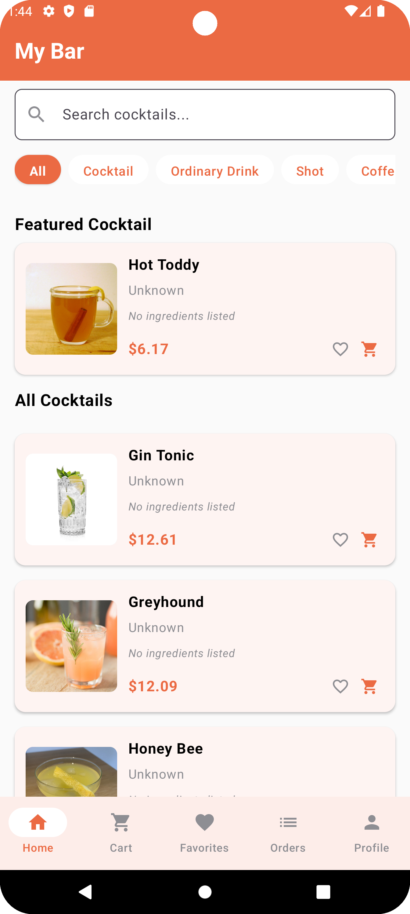
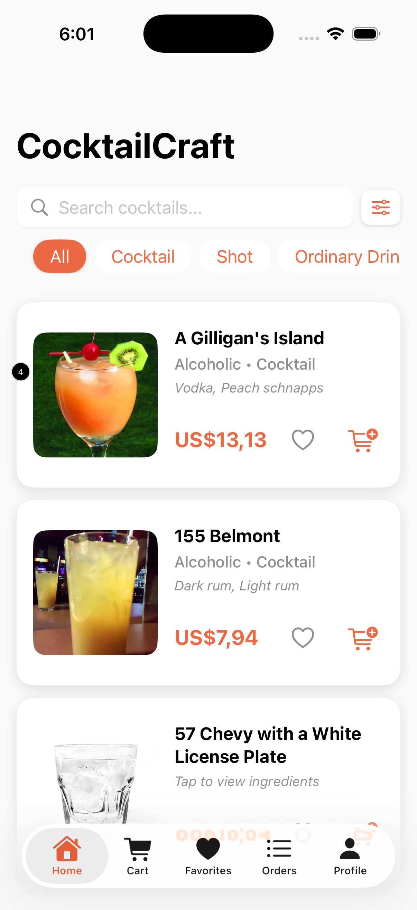

# CocktailCraft App

## Overview
CocktailCraft is a Kotlin Multiplatform project for a feature-rich cocktail ordering and discovery application, designed to run on both Android and iOS platforms. The app allows users to browse, search, and order various cocktails, manage their shopping cart, track orders, and maintain a profile. It leverages modern mobile app development practices including MVVM architecture, reactive programming, and dependency injection.

### Platform Status
- **Android**: ✅ Fully functional and production-ready
- **iOS**: ✅ Fully functional — complete SKIE integration (100%) with native Swift async/await patterns

<p align="center">
  
  
</p>

## Features
- **Cocktail Discovery**: Browse and search for cocktails with detailed information
- **Advanced Search & Filtering**: Combine a name query with category, ingredient, and alcoholic/non-alcoholic filters
- **Shopping Cart**: Add cocktails to cart, update quantities, and checkout
- **User Authentication**: Register, login, and manage user profiles
- **Order Management**: Place orders and track order history
- **Favorites**: Save and manage favorite cocktails
- **Reviews**: Read and submit reviews for cocktails
- **Personalized Recommendations**: "You might also like" suggestions based on viewing history and preferences
- **Dark Mode Support**: Adaptive UI that supports both light and dark themes with smooth transitions
- **Offline Mode**: Browse recently viewed cocktails and favorites without internet connection
- **Background Sync**: Automatic data synchronization when app is backgrounded for fresh content on launch
- **Home Screen Widgets**: Android and iOS (WidgetKit) widgets with deep links into the app
- **Localization**: One shared set of UI strings for both platforms (moko-resources in `:core:resources`) with locale-aware prices
- **Robust Error Handling**: User-friendly error messages with recovery options
- **Polished Animations**: Enhanced user experience with smooth animations and micro-interactions
- **Cross-Platform**: Same codebase for both Android and iOS platforms with platform-specific UI components
- **Native iOS Integration**: Complete SKIE integration (100%) with Swift async/await and modern SwiftUI reusable components

## Architecture
The application follows the **Clean Architecture** pattern with **MVVM** (Model-View-ViewModel) for presentation, reactive state management, and a modular **Dependency Injection** system:

```
┌─────────────────────────────────────────────────────────────────────────────────┐
│                              Presentation Layer                                  │
│                                                                                  │
│  ┌─────────────┐       ┌─────────────────┐       ┌───────────────────┐          │
│  │   Screens   │◄─────►│    ViewModels   │◄─────►│    UI Elements    │          │
│  │  (Compose)  │       │(SharedViewModel)│       │ (Compose/Material)│          │
│  └─────────────┘       └─────────────────┘       └───────────────────┘          │
│         ▲                       ▲                         ▲                      │
│         │                       │                         │                      │
│         ▼                       ▼                         ▼                      │
│  ┌─────────────┐       ┌─────────────────┐       ┌───────────────────┐          │
│  │  Navigation │       │  State Handling │       │   Theme Manager   │          │
│  │  (Compose)  │       │  (StateFlow)    │       │   (Dark Mode)     │          │
│  └─────────────┘       └─────────────────┘       └───────────────────┘          │
└─────────────────────────────────┬─────────────────────────────────────────────┘
                                  │
┌─────────────────────────────────▼─────────────────────────────────────────────┐
│                               Domain Layer                                     │
│                                                                                │
│  ┌─────────────┐       ┌─────────────────┐       ┌───────────────────┐        │
│  │   Models    │       │    Use Cases    │       │    Repositories   │        │
│  │             │       │                 │       │    (Interfaces)   │        │
│  └─────────────┘       └─────────────────┘       └───────────────────┘        │
└─────────────────────────────────┬─────────────────────────────────────────────┘
                                  │
┌─────────────────────────────────▼─────────────────────────────────────────────┐
│                               Data Layer                                       │
│                                                                                │
│  ┌─────────────┐       ┌─────────────────┐       ┌───────────────────┐        │
│  │ Repository  │       │   Data Sources  │       │      Mappers      │        │
│  │    Impl     │◄─────►│ Remote / Local  │       │                   │        │
│  └─────────────┘       └─────────────────┘       └───────────────────┘        │
│         ▲                       ▲                                              │
│         │                       │                                              │
│         ▼                       ▼                                              │
│  ┌─────────────┐       ┌─────────────────┐                                    │
│  │   Offline   │       │  Error Handling │                                    │
│  │   Support   │       │  (ErrorUtils)   │                                    │
│  └─────────────┘       └─────────────────┘                                    │
└─────────────────────────────────┬─────────────────────────────────────────────┘
                                  │
┌─────────────────────────────────▼─────────────────────────────────────────────┐
│                         Dependency Injection                                   │
│                                                                                │
│  ┌─────────────┐       ┌─────────────────┐       ┌───────────────────┐        │
│  │  Network    │       │      Data       │       │      Domain       │        │
│  │   Module    │       │     Module      │       │      Module       │        │
│  └─────────────┘       └─────────────────┘       └───────────────────┘        │
│                                                                                │
│  ┌─────────────────────────────────────────────────────────────────────┐      │
│  │                          Platform Module                             │      │
│  └─────────────────────────────────────────────────────────────────────┘      │
└────────────────────────────────────────────────────────────────────────────────┘
```

### Module Structure
The shared Kotlin code is split into Gradle modules, one per layer, so the
Clean Architecture dependency rules are enforced by the build: a layer can
only use what its module depends on.

```
  androidApp (Compose)                   iosApp (SwiftUI: `import shared`)
        │ implementation                        │ links the static framework
        ▼                                       ▼
  ┌────────────────────────────────────────────────────────┐
  │ :shared — umbrella: builds the `shared` iOS framework  │
  │ (SKIE), export()s the API modules, assembles Koin      │
  │ (initKoin, appModule, platformModule(), KoinHelper)    │
  └────────────────────────────────────────────────────────┘
        │ api + export()                             │ implementation
        │ (also :core:domain, :core:common,          │ (not exported,
        │  :core:resources, :core:designsystem)      │  not visible to the apps)
        ▼                                            ▼
  ┌────────────────────┐                       ┌────────────────────┐
  │ :presentation      │                       │ :core:data         │
  │ shared ViewModels, │                       │ repository impls,  │
  │ UiState            │                       │ Ktor, SQLDelight,  │
  └────────────────────┘                       │ Settings, drivers  │
                                               └────────────────────┘
             │ api                                     │ api
             └──────────────────┐   ┌──────────────────┘
                                ▼   ▼
                        ┌──────────────────────────┐
                        │ :core:domain             │                      ┌────────────────────┐
                        │ models, repository       │ ── implementation ─► │ :core:designsystem │
                        │ interfaces, use cases,   │                      │ DesignTokens       │
                        │ validators               │                      └────────────────────┘
                        └──────────────────────────┘
                                     │ api
                                     ▼
                        ┌──────────────────────────┐
                        │ :core:common             │
                        │ Result/ErrorCode,        │
                        │ ErrorHandler,            │
                        │ NetworkMonitor, UUID     │
                        └──────────────────────────┘
                                     │ api
                                     ▼
                        ┌──────────────────────────┐
                        │ :core:resources          │
                        │ moko strings (MR)        │
                        └──────────────────────────┘

  :core:testing — test-only fakes, test data, MainDispatcherTest (api :core:domain)
```

| Module | Contents | Depends on |
|--------|----------|------------|
| `:core:resources` | moko-resources strings/plurals → `com.cocktailcraft.resources.MR` | moko-resources (api) |
| `:core:designsystem` | `DesignTokens` (colors, spacing, typography) | — |
| `:core:common` | `Result`/`ErrorCode`/`DomainException`, `ErrorHandler`, the `NetworkMonitor` contract, `UUID` | resources (api); Ktor core (implementation — only for exception types) |
| `:core:domain` | models, repository interfaces, use cases, `AppConfig`, `DeliveryPolicy`, validators, `domainModule` | common (api), designsystem (implementation) |
| `:core:data` | repository implementations, Ktor remote + DTOs, SQLDelight database, Settings/secure storage, platform `NetworkMonitor`s and drivers, `networkModule`/`dataModule`/`dataPlatformModule()` | domain (api); Ktor, SQLDelight, Settings (implementation) |
| `:presentation` | shared ViewModels + UiState, `presentationModule` | domain (api), androidx ViewModel (api), designsystem (implementation) |
| `:shared` | umbrella: iOS framework, Koin assembly, `KoinHelper` | presentation/domain/common/resources/designsystem (api + `export`), data (implementation) |
| `:core:testing` | test doubles shared across suites (only ever a test dependency) | domain (api) |

**Dependency rules**
- `:presentation` → `:core:domain` ← `:core:data`. The domain depends on
  nothing app-specific (no Ktor, SQLDelight, Settings or platform drivers);
  `:presentation` cannot see `:core:data` — repositories reach the ViewModels
  through Koin as domain interfaces.
- `api` only where a module's public API exposes the dependency's types;
  everything else is `implementation`, so e.g. Ktor stays off the domain and
  presentation compile classpaths.
- Only `:shared` depends on `:core:data`, with `implementation`: androidApp
  and Swift never see data-layer types, and the framework doesn't export them.
  Each module exposes its own Koin module; `:shared` assembles them (see
  [Dependency Injection](docs/DependencyInjection.md)).
- Swift sees exactly the `export()`ed modules (`:presentation`,
  `:core:domain`, `:core:common`, `:core:resources`, `:core:designsystem`);
  helpers that must be public for another Kotlin module but aren't Swift API
  are `@HiddenFromObjC` (AR-12).
- Package names did not change with the split (e.g. `Result` is still
  `com.cocktailcraft.domain.util.Result`, in `:core:common`).
- The KMP setup (targets, toolchain, SDK levels, opt-ins, host tests) comes
  from the `cocktailcraft.kmp.library` convention plugin in `build-logic/`
  (AR-10), so each module's build file only lists its dependencies.

### Key Architecture Components:
- **Shared Modules**: Common business logic, models, repositories and ViewModels used by both platforms, layered into the Gradle modules above
- **Platform-Specific Apps**: Android and iOS implementations with platform-specific UI and functionality
- **MVVM Pattern**: Separates UI (View) from business logic (ViewModel) and data management (Model)
- **Repository Pattern**: Abstracts data sources and provides a clean API for the domain layer
- **Use Case Pattern**: Encapsulates business logic in single-responsibility classes
- **Dependency Injection**: Modular Koin setup for better testability and separation of concerns

### Architecture Layers:
- **Presentation Layer**:
  - **Screens**: Platform-specific UI components that display data and handle user interactions
    - **Android**: Jetpack Compose UI components (see [Android UI Components Documentation](docs/UI_Components.md))
    - **iOS**: SwiftUI views and components (see [iOS UI Components Documentation](docs/iOS_UI_Components.md))
  - **ViewModels**: Manage UI state, process user actions, and communicate with the domain layer
  - **UI Elements**: Reusable components for consistent UI across platforms
  - **SharedViewModel**: Multiplatform base class (on androidx `ViewModel`) with the shared error channel; ViewModels are constructor-injected and registered in Koin
  - **Navigation**: Compose Navigation for handling screen transitions and deep linking
  - **State Handling**: Kotlin StateFlow and SharedFlow for reactive UI updates
  - **Theme Manager**: Manages light/dark mode and theme preferences with smooth transitions

- **Domain Layer**:
  - **Models**: Core business entities that represent the application's data structures
  - **Use Cases**: Business logic operations that orchestrate data flow between UI and data layers
  - **Repository Interfaces**: Define contracts for data access without implementation details
  - **Business Rules**: Encapsulate application-specific business logic and validation

- **Data Layer**:
  - **Repository Implementations**: Concrete implementations of repository interfaces
  - **Data Sources**: Remote (API) and local (cache/database) data access
  - **Mappers**: Convert between data models and domain models
  - **Network Utilities**: Handle API communication, caching, and offline support
  - **Offline Support**: CocktailCache and NetworkMonitor for offline functionality
  - **Error Handling**: Centralized error handling with ErrorUtils and recovery options

- **Dependency Injection Layer**:
  - **Network Module** (`:core:data`): Provides the HTTP client and API
  - **Data Module** (`:core:data`): Provides repositories and caching mechanisms
  - **Domain Module** (`:core:domain`): Provides use cases
  - **Presentation Module** (`:presentation`): Provides the shared ViewModels
  - **Platform Module** (`:core:data`, exposed by `:shared`): Provides platform-specific dependencies (Settings, SqlDriver, NetworkMonitor, AppConfig)

### Cross-Cutting Concerns:
- **Error Handling**: Standardized error handling through SharedViewModel with user-friendly messages
- **Offline Mode**: Network state monitoring and data caching for offline access
- **Reactive Programming**: Kotlin Flow for asynchronous data streams and UI updates
- **Dependency Injection**: Modular Koin setup for better testability and separation of concerns
- **Dark Mode**: System-integrated and user-configurable theme preferences

For more detailed architecture diagrams, please see the [Documentation Index](docs/README.md), which links to the mermaid diagrams (high-level architecture, component, use case, class, sequence, data flow, and package diagrams).

### Animations and Transitions
The app features a focused set of animations to enhance the user experience:
- **Micro-interactions**: Press-scale animations on buttons, icon buttons, and FABs, with optional haptic feedback
- **List Animations**: Item entrance and placement animation via Compose's built-in `animateItem()` on identity-keyed list items
- **Loading States**: Shimmer loading placeholders driven by a single shared transition per loading container
- **Theme Transitions**: Animated color transitions when switching between light and dark modes, plus a custom animated theme switch

For detailed information about the animations implementation, see the [Animations section of the UI Components documentation](docs/UI_Components.md#animations).

### Dependency Injection
The app uses Koin for dependency injection with a modular approach:
- **Modular Structure**: Each Gradle module exposes its own Koin module (network, data, domain, presentation, platform); `:shared` assembles them into `appModule`
- **Testability**: Easy mocking and test module setup
- **ViewModel Integration**: Standardized pattern for ViewModel dependency injection

For detailed information about the dependency injection implementation, see:
- [Dependency Injection Documentation](docs/DependencyInjection.md) - Overview, module structure, and best practices

## Libraries Used

### Core & Architecture
- **Kotlin Multiplatform**: For sharing code between Android and iOS
- **Coroutines + Flow**: For asynchronous programming and reactive streams
- **Koin**: For dependency injection
- **Ktor**: For networking and API calls
- **Kotlinx.Serialization**: For JSON parsing
- **SQLDelight**: SQLite storage for the cart, orders, favorites, reviews and offline cocktail cache, with reactive `Flow` queries
- **Multiplatform Settings**: Encrypted key-value storage for auth data (EncryptedSharedPreferences / Keychain)

### UI & Navigation
- **Jetpack Compose**: Modern declarative UI toolkit for Android
- **Material3**: For consistent Material Design implementation
- **Navigation Compose**: For handling navigation between screens
- **Coil**: For image loading and caching on Android
- **Kingfisher**: For image loading with disk/memory caching on iOS
- **Animation Utilities**: Custom animation components and utilities for enhanced UX
- **Shimmer Effects**: Loading state animations with shimmer effects

### Testing
- **JUnit Jupiter**: Modern unit testing framework
- **kotlin-test**: Multiplatform testing support
- **Jetpack Compose UI Testing**: UI testing for Compose
- **Mockk**: Kotlin-friendly mocking library
- **Turbine**: For testing Flow emissions
- **XCUITest**: iOS UI testing framework
- **Koin Test**: Dependency injection testing utilities
- **Robolectric**: Android unit testing framework
- **Roborazzi** / **swift-snapshot-testing**: Screenshot tests on Android / iOS

**Testing Setup:**
- [Testing Implementation Summary](docs/TESTING_IMPLEMENTATION_SUMMARY.md) - Complete testing framework overview and setup

See the [Testing](#testing) section below for where the test suites live and how to run them.

For a detailed list of all libraries with versions and purposes, see the [Libraries Documentation](docs/Libraries.md).

For information about the reusable UI components in the app, see:
- [Android UI Components Documentation](docs/UI_Components.md) - Jetpack Compose components and design system
- [iOS UI Components Documentation](docs/iOS_UI_Components.md) - SwiftUI components and design system

For details about the iOS migration, SKIE implementation, and native Swift async/await integration, see the [SKIE Full Migration Guide](docs/SKIE_FULL_MIGRATION_GUIDE.md).

## Package Structure

### Domain Layer (`core/domain`)
- **Models**: Data classes representing core business entities like `Cocktail`, `User`, `Order`, etc.
- **Repositories**: Interfaces defining data access contracts
- **UseCases**: Business logic operations and workflows

### Data Layer (`core/data`)
- **Repository Implementations**: Concrete implementations of repository interfaces
- **Remote Data Sources**: API clients and network-related code
- **Local Data Sources**: SQLDelight database (`data/local/LocalDatabase`, `data/cache/CocktailCache`) and secure preference storage for auth

### Presentation Layer
- **Shared ViewModels** (`presentation`): Manage UI state and handle user interactions on both platforms
- **Screens**: Compose UI components representing app screens (`androidApp`) and SwiftUI views (`iosApp`)
- **UI Elements**: Reusable UI components

## Key Features Implementation

### Cart Functionality
- **SharedCartViewModel**: Manages cart state and operations like adding/removing items and checkout
- **CartRepository**: Persists the cart in SQLite and streams changes; checkout (`OrderRepository.placeOrderAndClearCart`) stores the order and empties the cart in one transaction
- **CartScreen**: UI for displaying and managing cart items

### User Authentication
- **AuthRepository**: Handles user registration, login, and session management
- **SharedProfileViewModel**: Manages user profile data and settings
- **ProfileScreen**: UI for user authentication and profile management

### Cocktail Discovery
- **SharedHomeViewModel**: Manages cocktail listings, categories, and search
- **CocktailSearchRepository / CocktailCatalogRepository / CocktailDetailRepository**: Focused repositories providing cocktail data from remote and cached sources
- **HomeScreen & CocktailDetailScreen**: UI for browsing and viewing cocktail details

### Recommendation System
- **GetCocktailDetailUseCase.getRelatedCocktails**: Client-side, category-based related-cocktail suggestions
- **Detail screen sections**: "You might also like" carousels on both platforms, fed by `relatedCocktails` in the shared detail state
- **Offline Support**: Works with cached data when no internet connection is available

### Dark Mode Support
- **SharedThemeViewModel**: Manages theme state and preferences
- **AnimatedCocktailBarTheme** (Android) / **AppTheme** (iOS): Provide theme-specific colors and typography from the shared design tokens. On Android every color is read from `MaterialTheme.colorScheme` or `CocktailCraftTheme.extendedColors` (see [UI_Components.md](docs/UI_Components.md#theming-and-colors))
- **ThemeAwareComponents**: UI components that adapt to the current theme
- **Smooth Transitions**: Animated transitions between light and dark modes
- **System Integration**: Option to follow system theme settings

### Offline Mode
- **NetworkMonitor**: Detects and monitors network connectivity
- **CocktailOfflineRepository**: Owns offline mode, connectivity checks, recently viewed, and cache clearing
- **OfflineModePolicy + CocktailCache**: Single source of truth for "is the app offline" and the cached-data fallback used by the other cocktail repositories
- **UI Indicators**: Clear indicators of offline status and available actions

### Error Handling
- **ErrorUtils**: Centralized error handling and categorization
- **SharedViewModel**: Common error handling for all ViewModels
- **ErrorDialog & ErrorBanner**: User-friendly error display components
- **Recovery Actions**: Actionable error messages with recovery options
- **Localized copy**: Error titles, messages and actions are shared `StringDesc`s, resolved for the user's locale by each platform (see [Localization](#localization))

### Localization
The app's user-facing strings have a single source in the `:core:resources`
module, managed by [moko-resources](https://github.com/icerockdev/moko-resources):

```
core/resources/src/commonMain/moko-resources/
├── base/strings.xml    # English (base) — every UI, widget and error string
├── base/plurals.xml    # count-dependent copy
└── <lang>/strings.xml  # a translation (none ship yet)
```

At build time moko-resources generates the `MR.strings` / `MR.plurals`
accessors (package `com.cocktailcraft.resources`), Android string resources in
that module, and an iOS `Localizable.strings`/`.stringsdict` bundle that the
`shared` framework build collects and the iOS app's "Compile Kotlin Framework"
phase copies into the app (the shared framework is static, so it cannot carry
the bundle itself). The other KMP modules apply the moko plugin without
resources of their own, only so their iOS test executables get the bundle.

| Where | How to use a string |
|-------|---------------------|
| Shared Kotlin (ViewModels, `ErrorHandler`, validators) | Return/emit a `StringDesc` — `MR.strings.key.desc()`, `MR.strings.key.format(arg)`, or `StringDesc.Raw(text)` for untranslated data-layer text. Never resolve it in shared code: `UserFriendlyError.title/message`, `RecoveryAction.actionLabel` and the theme/order display names are `StringDesc`s. |
| Android Compose | `stringResource(MR.strings.key)`, `stringResource(MR.strings.key, arg)`, `pluralStringResource(MR.plurals.key, count, count)` and `desc.resolve()` from `androidApp/.../util/SharedStrings.kt` |
| Android Glance widgets / non-Compose | `context.getString(MR.strings.key, …)` (same file) |
| iOS SwiftUI | `L(\.key)`, `L(\.key, arg1, arg2)`, `L(\.key, count: n)` from `iosApp/CocktailCraft/Utils/Strings.swift`; `desc.localized()` for a shared `StringDesc` |

**Adding a string**: add it to `base/strings.xml` (or `plurals.xml`) with a
readable `snake_case` key grouped by screen, escaped like an Android resource
(`\'`, `\"`, `&amp;`), with positional format arguments (`%1$s`, `%2$d`) so a
translation can reorder them. Build once (or run `./gradlew
:core:resources:generateMRcommonMain`) and use it from either platform as above. On
iOS, pass Swift `Int`s/`String`s as the arguments — every specifier is
formatted as an object, so avoid precision specifiers like `%.2f` in strings
iOS uses (prices are formatted separately, see below). Keys ending in `_ios`
hold copy that currently differs from the Android wording of the same element;
unifying such a pair is a visual change that needs the screenshot baselines
re-recorded.

**Adding a language**: create `core/resources/src/commonMain/moko-resources/<lang>/strings.xml`
(and `plurals.xml` with that language's plural quantities) translating the
base keys — untranslated keys fall back to English — then add the language
code to `CFBundleLocalizations` in `iosApp/CocktailCraft/Info.plist` so iOS
offers it. Android needs nothing else (moko generates `values-<lang>`).
Translate the native leftovers below as well.

**Still native, and why**:
- **iOS widget extension** (`iosApp/CocktailCraftWidgets/Localizable.xcstrings`):
  the extension does not link the shared framework — it renders App Group
  snapshots written by the app, and pulling the Kotlin/Native framework and
  runtime into a memory-capped extension for ten strings isn't worth it — so
  it cannot read the shared bundle.
- **Android OS-read metadata** (`androidApp/src/main/res/values/strings.xml`):
  the launcher label, the widget picker names/descriptions and the static
  widget preview layouts, which the system reads from the app's own resources
  (their iOS counterparts are the widget's `configurationDisplayName`s).
- The Debug-only DebugSwift menu labels, which never ship.

Prices stay locale-aware and are formatted per platform, not through strings
(IO-6).

## Test Coverage
The application includes comprehensive test coverage:

- **Unit Tests**: Testing individual components in isolation
- **Integration Tests**: Testing component interactions
- **ViewModel Tests**: Verifying ViewModel behavior and state management
- **Repository Tests**: Testing data access and manipulation
- **UI Tests**: Verifying screen workflows and user interactions

## Setup & Running the Project
1. **Clone the Repository**:
   ```bash
   git clone <repository-url>
   cd CocktailCraft
   ```

2. **Open the Project**:
   - Open the project in Android Studio.

3. **Sync the Project**:
   - Allow Gradle to sync and download all necessary dependencies.

4. **Run on Android**:
   - Select the `androidApp` configuration
   - Choose an emulator or device
   - Click Run

5. **Run on iOS** (macOS only):
   - Navigate to `iosApp` directory: `cd iosApp`
   - Generate the Xcode project from the spec: `xcodegen generate` (`brew install xcodegen`)
   - Open `CocktailCraft.xcodeproj` in Xcode — no CocoaPods: Swift packages resolve automatically, and the shared Kotlin framework is built by the app's "Compile Kotlin Framework" build phase
   - Select a simulator and run the app
   - See [iOS Setup Instructions](iosApp/iOS_Setup_Instructions.md) for detailed setup

## Development Setup
- **Android Studio**: Latest version recommended (Flamingo or newer)
- **JDK**: Version 17 or higher
- **Xcode**: Latest version (for iOS development)
- **Gradle**: Managed by the project
- **Git**: For version control

## Troubleshooting
- **Build Issues**: Try cleaning and rebuilding the project
- **KMP Plugin Issues**: Make sure the Kotlin Multiplatform plugin is up to date
- **iOS Builds**: ✅ **Working with SKIE integration!** See [iOS Setup Instructions](iosApp/iOS_Setup_Instructions.md) and the [SKIE Full Migration Guide](docs/SKIE_FULL_MIGRATION_GUIDE.md) for details
- **iOS Build Warnings**: Non-blocking warnings exist (see iOS documentation for details)
- **Dependency Resolution**: Check Gradle settings and the `libraries.toml` version catalog

## Documentation

### 📚 **Core Documentation**
- [Documentation Index](docs/README.md) - Index of all project documentation
- [iOS Background Sync Implementation](docs/ios-background-sync.md) - Comprehensive guide to the background sync feature
- [iOS Setup Instructions](iosApp/iOS_Setup_Instructions.md) - Complete iOS development setup
- [SKIE Full Migration Guide](docs/SKIE_FULL_MIGRATION_GUIDE.md) - iOS compatibility and SKIE integration details

### 🐛 **QA & Debugging Tools**
- [DebugSwift Guide](docs/DebugSwift.md) - iOS debugging tool integration and usage for QA testing

### 🔧 **Technical Guides**
- **Background Sync**: Automatic data synchronization for iOS with BGTaskScheduler integration
- **SKIE Integration**: 100% native Swift async/await patterns for seamless iOS development
- **Architecture**: Clean Architecture with MVVM pattern and dependency injection
- **Cross-Platform**: Shared business logic with platform-specific UI implementations

## Contributing
Contributions are welcome! Please follow the standard GitHub flow:
1. Fork the repository
2. Create a feature branch
3. Make your changes
4. Submit a pull request


## Testing

The test suites live alongside the code they cover — the tests themselves are the up-to-date catalog:

- **Shared (KMP)**: each module's `src/commonTest` (plus `androidHostTest`/`iosTest`), next to the code it covers — `presentation` (ViewModels), `core/domain` (use cases, policies, validators), `core/data` (repositories, cache, API, database, data DI), `core/common` (`ErrorHandler`), and `shared` (full DI graph, `KoinHelper`, Android string resolution). Shared fakes live in the test-only `core/testing` module.
- **Android**: `androidApp/src/test` (unit) and `androidApp/src/androidTest` (instrumented/UI)
- **iOS**: `iosApp/CocktailCraftTests` (unit) and `iosApp/CocktailCraftUITests` (XCUITest)

Run them with:

```bash
./gradlew testAndroidHostTest               # Shared (KMP) tests, every module, on the JVM
./gradlew iosSimulatorArm64Test             # the same suites on the iOS simulator
./gradlew :androidApp:testDebugUnitTest     # Android unit tests (incl. screenshot verify)
# iOS (from iosApp/, after xcodegen generate):
xcodebuild test -project CocktailCraft.xcodeproj -scheme CocktailCraft \
  -destination 'platform=iOS Simulator,name=iPhone 16 Pro,OS=18.5'
```

### Screenshot tests

Both platforms snapshot the design-system components and the stateless parts
of the main screens in light and dark mode, plus high-contrast, large-font
(including Android's 2x maximum and iOS's largest accessibility size, AX5) and
accent-color variants of a few key components and screens. Reference images are committed;
a visual change fails the test until the references are re-recorded and the
new images reviewed in the diff. Sample data never carries image URLs, so no
test touches the network.

**Android** — [Roborazzi](https://github.com/takahirom/roborazzi) on
Robolectric (JVM, no emulator). Tests live in
`androidApp/src/test/java/com/cocktailcraft/android/screenshot`, references in
`androidApp/src/test/screenshots`. A plain `testDebugUnitTest` run verifies
(`roborazzi.test.verify=true` in `gradle.properties`).

```bash
./gradlew :androidApp:recordRoborazziDebug    # re-record references after an intended change
./gradlew :androidApp:verifyRoborazziDebug    # verify only (same as testDebugUnitTest)
./gradlew :androidApp:compareRoborazziDebug   # write *_compare.png diffs without failing
```

Failed comparisons write `*_compare.png` / `*_actual.png` to
`androidApp/build/outputs/roborazzi`. Robolectric is pinned to SDK 34 and a
360x640dp xhdpi window (`androidApp/src/test/resources/robolectric.properties`);
references were recorded on macOS — font rasterization can differ slightly
on Linux CI.

**iOS** — [swift-snapshot-testing](https://github.com/pointfreeco/swift-snapshot-testing)
(Swift package, `CocktailCraftTests` target only). Tests live in
`iosApp/CocktailCraftTests/Snapshots`, references in its `__Snapshots__`
folder. Renders use a fixed width, @3x, phone traits, pinned Dynamic Type and
the scheme's `en`/`US` locale. **References must be recorded on the iPhone 16
Pro simulator running iOS 18.5**; on any other iOS runtime the snapshot tests
skip themselves (text rasterization differs between runtimes).

```bash
# from iosApp/ — verify (missing references are recorded and fail once)
xcodebuild test -project CocktailCraft.xcodeproj -scheme CocktailCraft \
  -destination 'platform=iOS Simulator,name=iPhone 16 Pro,OS=18.5' \
  -only-testing:CocktailCraftTests
# re-record every reference (the run reports failures; re-run to verify)
TEST_RUNNER_SNAPSHOT_TESTING_RECORD=all xcodebuild test -project CocktailCraft.xcodeproj \
  -scheme CocktailCraft -destination 'platform=iOS Simulator,name=iPhone 16 Pro,OS=18.5' \
  -only-testing:CocktailCraftTests
```

### Accessibility

Screen-reader semantics (labels, toggle/selected state, headings, grouping,
live regions/announcements, custom actions), touch targets, contrast,
Dynamic Type / font scale and reduced motion are checked automatically:

| Check | Where | Runs in |
|-------|-------|---------|
| Google's Accessibility Test Framework over Home, filters, detail, cart and profile content at 1x and 2x font scale (via Roborazzi's ATF integration; fails on warnings and errors) | `androidApp/src/test/.../accessibility/AccessibilityChecksTest.kt` | `./gradlew :androidApp:testDebugUnitTest` |
| Semantics assertions for the labels, states, headings, live regions and custom actions | `androidApp/src/test/.../accessibility/AccessibilitySemanticsTest.kt` | `./gradlew :androidApp:testDebugUnitTest` |
| Compose `enableAccessibilityChecks()` on the real `MainScreen`, walking every tab | `androidApp/src/androidTest/.../AccessibilityChecksTest.kt` | `./gradlew :androidApp:connectedDebugAndroidTest` (device/emulator) |
| Xcode accessibility audit (`performAccessibilityAudit`) on every tab and the detail screen, plus Home/Cart/Profile at AX5 | `iosApp/CocktailCraftUITests/AccessibilityAuditTests.swift` | the full iOS scheme (`xcodebuild test ...`) |
| Font-setting / Dynamic Type mapping and spoken ratings | `iosApp/CocktailCraftTests/AccessibilityTests.swift` | the full iOS scheme |
| Large-font and high-contrast screenshots (see above) | `LargeFontScreenshotTest`, `AccessibilityScreenshotTest` (both platforms) | the screenshot runs above |

The iOS audit is network-tolerant: it audits whatever state renders (content,
loading, offline, error), dismissing an error alert first, and hides the
Debug-only DebugSwift overlay (`HIDE_DEBUG_OVERLAY`), which never ships.

**Known exclusion — contrast.** The brand coral (`#EB6A43`, 3.2:1 on white),
the default secondary gray (`#8E8E93`, 3.3:1) and the success green are below
the 4.5:1 WCAG AA ratio for small text, so contrast checks are suppressed in
the ATF and Xcode audits rather than failing on a design decision. The iOS
in-app **High Contrast** setting strengthens secondary text (Android has no
in-app toggle; its theme still applies the shared setting, including the gray
outline role in light theme); changing the brand palette itself is out of
scope for these checks.

Conventions for new UI:
- Every user-facing label, hint, value and announcement is a shared string
  (see [Localization](#localization)); accessibility-only copy uses an `_a11y`
  key suffix.
- Toggles keep one stable label and expose their state (Compose
  `IconToggleButton`/`toggleable`, SwiftUI `.isSelected`/`.isToggle` traits)
  instead of a label that flips between "Add" and "Remove".
- Decorative images and icons next to text are hidden from screen readers;
  composite rows read as one element; section titles are headings.
- Touch targets are at least 48dp / 44pt; layouts wrap or stack at large
  text sizes instead of truncating.
- On iOS the in-app Font Size steps relative to the system Dynamic Type size
  (so accessibility sizes apply) and Reduce Motion follows the in-app setting
  or the system one. Android has no in-app Appearance section and follows the
  system font scale.

