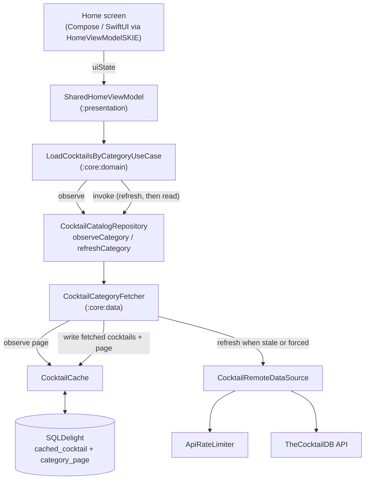

# Catalog Flow

How a Home category page reaches the screen. The database is the single
source of truth: the screen observes the stored page and a refresh writes
into the database, so the observer sees new data through the same flow
(and keeps showing the stored page when offline). The ViewModel holds the
whole stored page and shows it a page at a time (`CategoryPages` in
`HomeListing.kt`), so scrolling for more makes no request.

